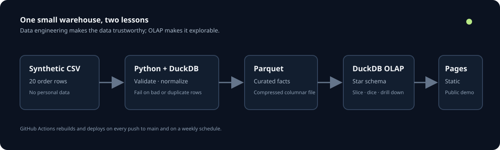

# SI-885 Unit 2: Data Engineering + OLAP

Two small, reproducible, AWS-free demonstrations built around one synthetic sales CSV:

- **Data Engineering:** Python + DuckDB validate and normalize the input, then write compressed Parquet.
- **OLAP:** DuckDB builds a date/product/region star schema and publishes grouped results for slicing and drill-down.
- **Automation and public SaaS:** GitHub Actions runs tests and rebuilds the static report; GitHub Pages serves the generated dashboard.

> The website is a static report. DuckDB executes during the build; this is not a live query service, production benchmark, or cloud data warehouse. Every record is synthetic.

## Run locally

~~~
python3.12 -m venv .venv
source .venv/bin/activate
python -m pip install -r requirements.txt
python -m unittest discover -s tests -v
python build_site.py
python -m http.server 8000 --directory _site
~~~

Open <http://localhost:8000>. To rerun the pipeline only: <code>python -m pipeline.run</code>.

## Architecture

The GitHub Actions workflow runs on pushes to <code>main</code>, manually, and weekly. The workflow needs GitHub Pages to use **GitHub Actions** as its publishing source. It declares only <code>contents: read</code>, <code>pages: write</code>, and <code>id-token: write</code>.

## Articles

- [Data Engineering: CSV to Parquet](articles/data-engineering.md)
- [OLAP: Star Schema and Drill-Down](articles/olap.md)

## Assignment checklist

- [x] Public source repository
- [x] Automated build and deployment workflow
- [x] Public SaaS deployment target (GitHub Pages)
- [x] Code examples and an architecture diagram
- [ ] Short public video (not created in this implementation)
- [ ] Share article/video links in the course Telegram group
- [ ] Upload a ZIP of links to AulaVirtualUPT

## References

- [DuckDB Python documentation](https://duckdb.org/docs/stable/clients/python/overview)
- [DuckDB Parquet documentation](https://duckdb.org/docs/stable/data/parquet/overview)
- [GitHub Pages with GitHub Actions](https://docs.github.com/en/pages/getting-started-with-github-pages/using-custom-workflows-with-github-pages)
