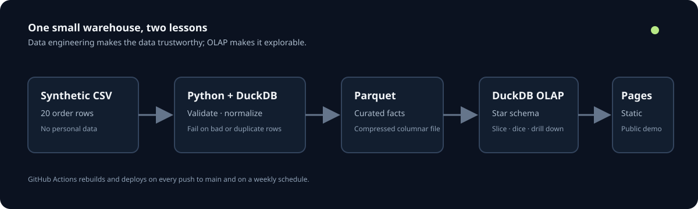

An OLAP query is most useful when it lets us ask the same business question at different levels of detail. “How much did we sell?” is a starting point. “How did revenue change by month, which region contributed, and which products explain that result?” is more actionable.

This example builds a compact analytical model from the curated output of a Python + DuckDB pipeline. It creates a star schema with one sales fact and three dimensions—date, product, and region—then computes groupings for a small static dashboard. The orders are synthetic; the query engine is DuckDB; and the public demo is hosted on GitHub Pages, without AWS.

**Explore:** [live OLAP report](https://andre-carbajal.github.io/si885-u2-analytics-lab/olap/) · [source repository](https://github.com/andre-carbajal/si885-u2-analytics-lab)

## Start from a grain

The grain of <code>fact_sales</code> is **one order line**. In a larger commerce warehouse, an order may have multiple product lines; this demo keeps one product/category per order so the example remains easy to inspect. The fact holds the measurable values (<code>quantity</code>, <code>unit_price</code>, and <code>revenue</code>) plus keys to dimensions.

~~~text
                    dim_date
                       |
 dim_region ───── fact_sales ───── dim_product
~~~

The <code>date</code> dimension provides year, quarter, and month; <code>product</code> gives category and product; <code>region</code> provides the geographic slice. Surrogate keys keep the joins explicit, while the original order ID remains available for audit.

## Build the model with SQL

The Python builder in [olap/build.py](https://github.com/andre-carbajal/si885-u2-analytics-lab/blob/main/olap/build.py) reads the Parquet output and creates the dimensions and fact table. A simplified part of the model:

~~~sql
CREATE TABLE dim_date AS
SELECT ROW_NUMBER() OVER (ORDER BY order_date) AS date_key,
       order_date,
       STRFTIME(order_date, '%Y-%m') AS year_month,
       DATE_PART('year', order_date)::INTEGER AS year,
       DATE_PART('quarter', order_date)::INTEGER AS quarter
FROM (SELECT DISTINCT order_date FROM clean_sales);

CREATE TABLE fact_sales AS
SELECT s.order_id, d.date_key, p.product_key, r.region_key,
       s.quantity, s.unit_price, s.revenue
FROM clean_sales s
JOIN dim_date d USING (order_date)
JOIN dim_product p USING (product, category)
JOIN dim_region r USING (region);
~~~

The model stays deliberately small, but it still enforces a useful separation: facts represent events and measures, while dimensions describe the context in which those events occurred.

## Slice, compare, then drill down

A monthly rollup answers “how did sales change over time?”:

~~~sql
SELECT d.year_month, SUM(f.revenue) AS revenue, COUNT(*) AS orders
FROM fact_sales f
JOIN dim_date d USING (date_key)
GROUP BY d.year_month
ORDER BY d.year_month;
~~~

A regional and category rollup changes the grouping without changing the facts:

~~~sql
SELECT r.region, p.category, SUM(f.revenue) AS revenue
FROM fact_sales f
JOIN dim_region r USING (region_key)
JOIN dim_product p USING (product_key)
GROUP BY r.region, p.category
ORDER BY revenue DESC;
~~~

The published dashboard adds one more level—month, region, category, and product—so a reader can connect a summary back to its contributing records. This is a practical way to demonstrate roll-up and drill-down: aggregate first, then join additional dimensions to reveal a finer grain.

## Automation and the visible result

The [GitHub Actions workflow](https://github.com/andre-carbajal/si885-u2-analytics-lab/blob/main/.github/workflows/publish.yml) runs tests, rebuilds the Parquet dataset and OLAP output, and publishes the static dashboard to GitHub Pages. The [OLAP page](https://andre-carbajal.github.io/si885-u2-analytics-lab/olap/) shows total orders, sales value, average order value, monthly and regional bars, and the detailed drill-down table.

One distinction matters: **the site is static**. DuckDB executes during the automated build, and GitHub Pages serves those generated results. A user viewing the page does not open a live DuckDB session or submit an ad hoc query. That keeps hosting simple and free of a runtime database, but the displayed results change only when the workflow rebuilds.

## Why this model, and its limits

DuckDB is convenient here because it can query Parquet and execute analytical SQL in-process without a server to provision. It is a good fit for a small teaching/demo workload, not a blanket replacement for a shared warehouse or a database serving many concurrent analysts. A production OLAP platform would also need to handle incremental updates, retention, access control, data contracts, freshness, concurrency, and query monitoring.

The dashboard formats its synthetic numbers as Peruvian soles to match the demo regions, but the source has no real currency semantics. These values are not benchmarks or real sales data. The [repository](https://github.com/andre-carbajal/si885-u2-analytics-lab) contains the code, synthetic CSV, tests, and architecture diagram so the example can be reproduced or extended.

## Run it locally

~~~
python3.12 -m venv .venv
source .venv/bin/activate
python -m pip install -r requirements.txt
python -m unittest discover -s tests -v
python build_site.py
python -m http.server 8000 --directory _site
~~~

Open <http://localhost:8000/olap/> and compare the visible rollups with the SQL in <code>olap/build.py</code>.
